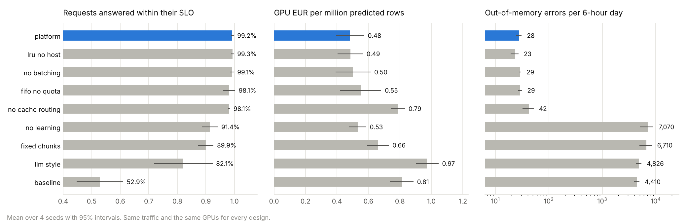
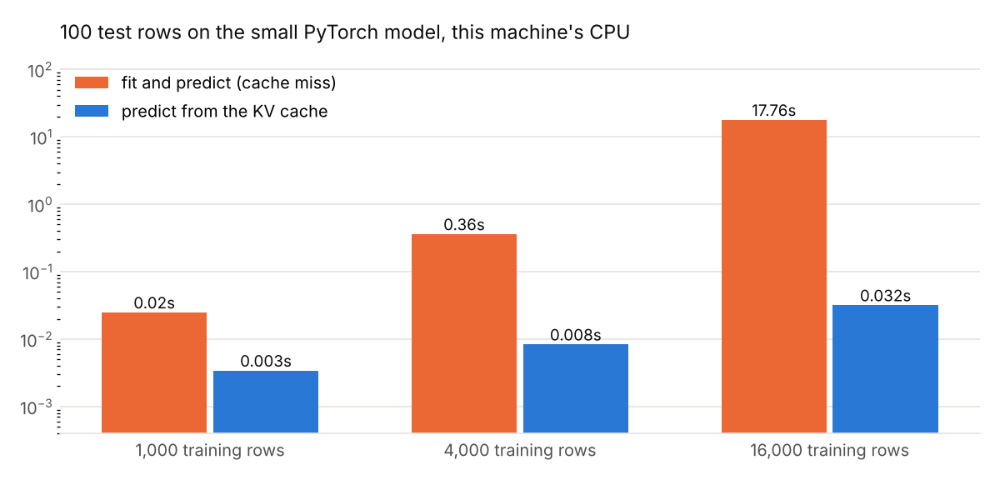
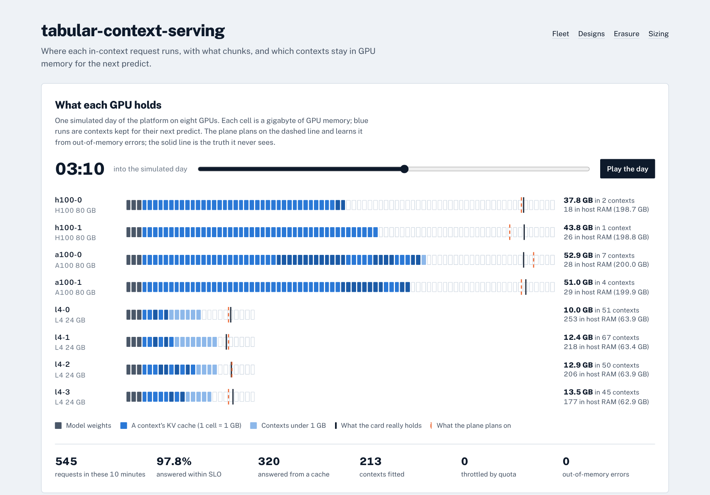

# tabular-context-serving

A serving plane for in-context tabular foundation models such as TabPFN.

A tabular foundation model does its learning in the forward pass, so "fit" is not training. It means running the
training rows through the network once. Prior Labs documents up to a million rows on one H100 for TabPFN-3, with a
KV cache that keeps the training side so later predicts only run the test rows. That turns serving into a memory
and placement problem that LLM serving stacks do not quite solve:

- A request is a context (up to a million training rows) plus test rows, not a prompt.
- The cache for one context can be tens of gigabytes, and it is worth keeping only if the context comes back.
- Whole-context attention runs a GPU out of memory long before the cache does.
- The cheapest GPU that meets the deadline is often not the fastest one.

This repository builds that serving path end to end:

- the plane that decides where and how each request runs;
- an HTTP API in front of a real PyTorch in-context model with a real KV cache;
- Terraform for GKE and a Helm chart;
- an evaluation that runs every design on the same simulated traffic and the same GPUs, and scores them against a
  truth the plane cannot see.

<!-- results:start -->

Dev campaign: 4 seeds × 6 simulated hours on 8 GPUs (2 H100, 2 A100, 4 L4), 14,824 customer requests a day plus a flooding tenant, every design on the same traffic. Commit `HEAD`.

| | Status quo | LLM-style serving | **This plane** |
|---|---:|---:|---:|
| Requests answered within their SLO | 52.9% | 82.1% | **99.2%** |
| Interactive p95 latency | 4,147 s | 195.3 s | **2.9 s** |
| Out-of-memory errors per day | 4,410 | 4,826 | **28** |
| GPU EUR per million predicted rows | 0.81 | 0.97 | **0.48** |
| Context fits (forward passes over the training rows) | 24,716 | 15,632 | **7,961** |
| Retries charged twice | 729 | 0 | **0** |
| Erased bytes still on GPUs or in the bucket 15 min after erasure | 0.00 GB | 1.42 GB | **0.00 GB** |



<details><summary>Every design, with 95% intervals over seeds</summary>

| Design | Requests in SLO | Interactive p95 | OOM errors / day | Failed requests | GPU EUR per M rows | Cache hit rate |
|---|---:|---:|---:|---:|---:|---:|
| **platform** | 99.2% ± 0.5 | 2.9 s | 28 | 4 | 0.48 ± 0.09 | 66.9% |
| baseline | 52.9% ± 8.2 | 4,146.7 s | 4,410 | 784 | 0.81 ± 0.07 | 0.0% |
| llm_style | 82.1% ± 10.2 | 195.3 s | 4,826 | 948 | 0.97 ± 0.07 | 34.5% |
| no_cache_routing | 98.1% ± 0.3 | 6.4 s | 42 | 20 | 0.79 ± 0.04 | 40.7% |
| fixed_chunks | 89.9% ± 2.7 | 1.6 s | 6,710 | 1,452 | 0.66 ± 0.07 | 73.8% |
| no_learning | 91.4% ± 2.7 | 3.1 s | 7,070 | 1,171 | 0.53 ± 0.06 | 70.0% |
| no_batching | 99.1% ± 0.6 | 2.9 s | 29 | 4 | 0.50 ± 0.11 | 67.7% |
| fifo_no_quota | 98.1% ± 2.1 | 6.0 s | 29 | 4 | 0.55 ± 0.13 | 65.1% |
| lru_no_host | 99.3% ± 0.4 | 2.6 s | 23 | 3 | 0.49 ± 0.08 | 66.7% |

- **baseline**: Status quo: refit the context on every predict, round-robin, whole-context attention, FIFO, no idempotency keys, erasure deletes the stored dataset only
- **fifo_no_quota**: The plane, but one FIFO queue per GPU and no tenant quotas
- **fixed_chunks**: The plane, but whole-context attention with no memory model
- **llm_style**: What an LLM serving stack would do: keep KV caches with LRU, send work to the least-loaded GPU, fixed chunks, FIFO
- **lru_no_host**: The plane, but LRU eviction and no host-RAM tier
- **no_batching**: The plane, but each request runs on its own
- **no_cache_routing**: The plane, but work goes to the least-loaded GPU whatever caches it holds
- **no_learning**: The plane, but the memory and time models stay at the benchmark prior
- **platform**: This plane: cache-aware routing with single-flight fits, memory-predicted chunking learned from telemetry, same-context batching, value-based eviction with a host-RAM tier, fair queues and quotas, idempotent ledger, verified erasure

</details>

Release gates (config/gates.toml):

| Gate | Value | Result |
|---|---:|---|
| slo attainment | 0.9921 | pass |
| slo gain over llm style | 0.1713 | pass |
| oom per 1000 requests | 1.855 | pass |
| cost share of llm style | 0.4962 | pass |
| double charges | 0 | pass |
| served after erasure | 0 | pass |
| erasure residual bytes | 0 | pass |
| flood p95 share of fifo | 0.391 | pass |

**The real model** (`scripts/bench.py`, PyTorch on this machine's CPU, 137,290 parameters):

- Cached and chunked predictions match the uncached forward pass to 3.3e-07 (largest absolute difference in a probability).
- At 16,000 training rows, 100 test rows take 17.76 s with a fit and 0.032 s from the KV cache (560×). The cache costs exactly 2,048 bytes per training row.
- Fitting 8,000 rows with whole-context attention grows resident memory by 2,092 MB; in 512-row query chunks by 275 MB, with the same answers.
- Mean accuracy over 8 datasets: small model 78.8%, logistic regression 84.3%, 5-NN 73.8%. It learns in the forward pass but is a toy next to TabPFN; it is here so the serving code runs a real model.



**Sizing advisor** for customer VPC deployments (`evals/advisor_eval.py`, 5 customer workloads, target 97% of requests in SLO, each choice then run in the simulated world to see what really happens):

| Choice | Meets the target in truth | Mean EUR per hour |
|---|---:|---:|
| **Advisor** (replays the customer's log through this plane) | 5 of 5 | 17.86 |
| Two H100s | 4 of 5 | 20.00 |
| One card that holds the largest context | 2 of 5 | 3.85 |

The cheapest pools that really meet the target average EUR 14.86 per hour. The advisor pays more on two busy workloads, where two L4s were enough and it chose A100s.

<!-- results:end -->

## Operator console

`web/` (React, TypeScript, Framer Motion) replays one platform day: what each GPU holds, cell by gigabyte, against
what the card really holds and what the plane plans on; every design on the same traffic; erasure certificates;
and the sizing advisor against the truth.



## What the plane decides

Each part is switched by a flag in `config/designs.toml`, and the ablations above switch them off one at a time.

| Part | What it does | Where |
|---|---|---|
| Content-addressed uploads | The dataset id is the SHA-256 of its canonical bytes, per tenant. The same table uploaded twice is one object, and its cache is found again. | `tcs/plane/store.py` |
| Cache-aware routing | Expected completion = queue + (fit, host reload or nothing) + predict. Among GPUs expected to finish inside half the SLO left, take the cheapest; otherwise the fastest. | `Plane._route` |
| Single-flight fits | A predict for a context already being fitted waits for that fit instead of fitting again. | `Plane._route`, `pending_fit` |
| Memory-planned chunking | Choose train-side and test-side chunk sizes so weights + resident caches + new cache + transient fit the card, evicting caches if needed. Chunking changes memory, never answers (`tests/test_model.py`). | `Plane._admit` |
| Learning from telemetry | Workers report measured peak memory, cache size and seconds. The plane plans memory at the 98th percentile of measured/predicted, and time at a running mean. An out-of-memory error lowers that card's usable-capacity estimate and steps the chunks down. | `tcs/plane/estimates.py` |
| Cache tiers and eviction | Value-based eviction (refit seconds saved per byte, GreedyDual-Size-Frequency), with a host-RAM tier reloaded over PCIe. | `Plane._evict` |
| Same-context batching | Queued requests for one context run as one job (test rows are independent, so this is exact). | `Plane._pick` |
| Fair queues and quotas | Per-GPU queues serve the tenant with the least recent GPU time first. A token bucket on estimated GPU-seconds throttles floods (429). | `Plane._pick`, `_take_quota` |
| Idempotent ledger | One execution and one charge per idempotency key: a SQLite primary key, Cloud SQL in production. | `tcs/plane/ledger.py` |
| Verified erasure | Erasure deletes the bucket objects, drops queued work, purges HBM and host-RAM caches on every worker, then asks every worker what it still holds before calling it done. Later requests get 410. | `Plane.erase` |
| Sizing advisor | For customer VPC and self-hosted deployments: it replays the customer's request log through this plane, calibrated by the managed fleet's telemetry, and picks the cheapest pool that meets the target. A model may phrase the recommendation; `check` refuses numbers the plan does not hold. | `tcs/advisor/sizing.py` |

## Architecture

```
            HTTPS (API key -> tenant)
                     |
          +----------v-----------+        reports: measured peak bytes, cache bytes, seconds, OOM
          |   FastAPI  (tcs/api) |<---------------------------------------------+
          +----------+-----------+                                              |
                     | Request                                                  |
          +----------v-------------------------------------------+    +---------+---------+
          | Plane (tcs/plane)                                    |    | Workers            |
          |  quota -> idempotency -> route -> queue -> admit -> dispatch -+->| PyTorch model + KV |
          |  memory model, time model, cache directory, ledger   |  job | caches (HBM, host) |
          +----------+-------------------------------------------+    +---------+---------+
                     | put / delete                                             |
          +----------v-----------+                                              |
          | Dataset bucket (GCS) |<---------------------- fit reads the context -+
          +----------------------+
```

The plane talks to workers only through the worker protocol (`docs/icd/worker.md`): run a job; evict, purge or
list caches; put or delete a dataset. The PyTorch worker (`tcs/api/torch_worker.py`) and the simulated fleet
(`world/fleet.py`) both implement it, so the code that serves HTTP requests is the code the evaluation measures.

## Run it

```bash
pip install -r requirements-dev.txt             # torch (CPU is fine), fastapi, pytest, ruff, scikit-learn, matplotlib
scripts/check.sh                                 # lint and tests, about two minutes
uvicorn tcs.api.app:app --port 8000              # the API with the small model
```

```bash
KEY="Authorization: Bearer dev-key-acme"
curl -s localhost:8000/v1/datasets -H "$KEY" -H 'content-type: application/json' \
  -d '{"X": [[0.1, 1.2], [0.9, 0.3], [0.2, 1.1], [1.0, 0.2]], "y": [0, 1, 0, 1]}'
# -> {"dataset_id": "<sha256>", "rows": 4, "features": 2, "deduplicated": false}
curl -s localhost:8000/v1/predict -H "$KEY" -H 'Idempotency-Key: job-17' -H 'content-type: application/json' \
  -d '{"dataset_id": "<sha256>", "X": [[0.15, 1.0]]}'
# -> {"cache": "miss", "classes": [0, 1], "probabilities": [[...]], ...}; the next predict is a "hit"
curl -s -X DELETE localhost:8000/v1/data -H "$KEY"   # erase: {"verified": true, "caches_left": 0, ...}
```

```bash
python3 -m evals.run --hours 1                   # every design, one simulated hour, nothing written
python3 -m evals.run                             # the dev campaign -> reports/dev.json (about five minutes)
python3 -m evals.advisor_eval                    # the sizing advisor against the truth -> reports/advisor.json
python3 scripts/bench.py                         # the real model on this CPU -> reports/bench.json
python3 -m evals.charts && python3 -m evals.readme && python3 -m evals.console_data
cd web && npm ci && npm run dev                  # the operator console
```

## Deploy

`deploy/terraform` creates:

- a private GKE cluster (Dataplane V2, Workload Identity, managed Prometheus);
- a system pool and one autoscaled pool per GPU kind (L4, A100 80 GB, H100 80 GB), tainted for GPU work;
- a dataset bucket encrypted with a CMEK key, with versioning and soft delete off, so an erased object is really
  gone and not recoverable for seven days, and a lifecycle rule that deletes uploads after 30 days;
- an Artifact Registry repository and the API's service account bound through Workload Identity.

`deploy/helm/tcs` runs the API on a pool (`--set pool=h100`) with a GPU limit, non-root read-only containers, a
PodDisruptionBudget, a NetworkPolicy and a PodMonitoring for `/metrics`. CI checks both: `terraform fmt`,
`terraform validate`, `helm lint`, `helm template`. It also builds the image and calls `/healthz` on it.

## Limits: what is real and what is simulated

- **Real:**
  - The PyTorch model, its KV cache and chunking, and their exactness.
  - The API, the plane's code, the ledger and erasure, run against the real worker.
  - The CPU timings and memory in `reports/bench.json`.
  - The Terraform and Helm, checked by CI but not applied to a project here.
- **Simulated:**
  - The GPU fleet and the traffic in `world/`.
  - The GPU memory and speed coefficients. They are set from public statements (a 1M-row context on one H100 with
    eight estimators; about 6.1 KB per training cell for the older fitted-model cache), not measured on Prior Labs
    hardware.
  - The euro figures, which are busy GPU time at list-like hourly prices, as if every pool scaled to zero when idle.
- **The small model is not TabPFN.** It has about 140k parameters and was trained for minutes on a synthetic prior.
  It has no row compression, so its attention memory grows with the context instead of its square root.
- **Known weak spots, from the numbers:**
  - Value-based eviction with a host tier is no better than LRU at this load (`lru_no_host`).
  - Batching adds little, because same-context requests rarely queue together here.
  - `fixed_chunks` shows a low interactive p95 only because its large requests fail and drop out of the latency
    sample. Its SLO column shows the cost.

## Repository map

| Path | What |
|---|---|
| `tcs/model/` | the small in-context model (`icl.py`) and its synthetic prior |
| `tcs/plane/` | the plane, memory and time models, ledger, content-addressed store |
| `tcs/api/` | FastAPI app and the PyTorch worker |
| `tcs/advisor/` | the sizing advisor and its number checker |
| `world/` | the simulated fleet, traffic and luck (truth; the plane never imports it) |
| `evals/` | operate designs, score against the truth, gates, held-out lock, charts, README block, console data |
| `web/` | the operator console (React, TypeScript, Framer Motion) |
| `deploy/` | Terraform (GKE, GCS, KMS, Workload Identity) and the Helm chart |
| `docs/` | ADRs, the worker protocol, held-out notes |
